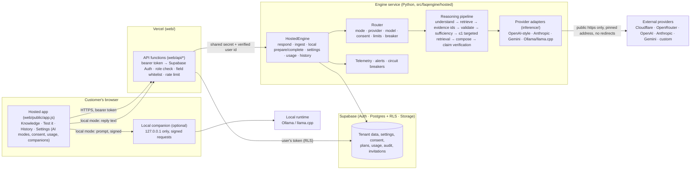
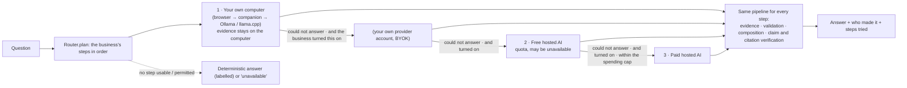

# Architecture

This is the architecture as built on 2026-11-02, with the line between **what runs** and **what has been exercised** drawn in each section. Nothing here has been deployed; "tested" means tested against a local PostgreSQL with every migration applied, the real embedding model, and stand-in providers over real HTTP (`docs/production-readiness.md` has the gate table).

## The whole system

Trust boundaries, outermost first: the browser is untrusted (it never names a provider, model, credential, role or user); the Vercel functions authenticate and authorise and forward only whitelisted fields; the engine service trusts only the shared secret and the user id the functions verified; the database enforces tenant isolation again with row-level security; providers' replies are untrusted text, checked claim by claim against evidence the service froze before the call.

## Local first: the order answers are tried in

**Local AI first, free hosted second, paid hosted third, with the business's own provider account (BYOK) as an optional preferred or alternative provider** (`docs/local-first.md` is the policy, its enforcement and the hardware rules). A business's settings name a *first step* and the steps that may follow it (always: its own provider account → free hosted → paid hosted; all off by default). `Router.plan` gives every step its verdict (usable, or why not); the service walks them in order and stops at the first that answers. A step is used only if the operator switched its mode on, its provider is verified, the business agreed to that provider's text, its limits allow it and its circuit is closed; a refused step is skipped with nothing sent. A failed provider or computer hands over to the next step the business enabled; a model whose answer failed verification, or a cancel, does not.

## The fast path: no model when the answer is already complete

Between *prepare* and *compose* the pipeline asks one more question: does the engine already hold a complete, current, verified answer? If the answer is an exact FAQ entry or a fully supported structured answer (a calculation, lookup, count or comparison worked out in code), every requirement of the question is established by accepted, current evidence of this business, and the deterministic answer passes the same claim and citation verification as any other, **no model is asked** and the answer is labelled `fast_path`. Any condition that fails leaves the request on the path it would have taken anyway (`Pipeline.evaluate_fast_path`, `conclude_fast`); it changes no consent, no fallback permission, no model selection and no setting, and a similarity score is never an input. `ENGINE_FAST_PATH=off` restores the previous behaviour. Conditions, measurements and limits: `docs/fast-path.md`.

## One pipeline, four ways of finishing it

Every question, in every mode, goes through the same stages (`runtime/pipeline.py`): understand the question → retrieve → normalise the evidence into immutable ids (E1, E2…) → validate each item (freshness, scope, conflicts) → judge sufficiency → at most **one** targeted second retrieval → compose → verify each claim against the cited evidence → resolve. What differs is who composes:

| Mode | Who composes the answer | Where the evidence goes | Credential |
|---|---|---|---|
| **Deterministic** (default) | Code: the best-supported evidence, calculations done in code | Nowhere. It never leaves the service. | none |
| **Platform-hosted** (the *free* and *paid* steps) | A model at a provider the operator offers, one model per tier, chosen by the operator | To that provider, after consent to **that** provider's **verified** disclosure text | the operator's, from the service's environment |
| **BYOK** | A model at the provider the business chose | To that provider, same consent rule | the business's own key, stored encrypted, decrypted only after every check passes |
| **Local** (the *first* step of every policy but BYOK-preferred) | A model on the business's own machine | To the person's browser and the companion on their computer; to no provider | none (a pairing secret between browser and companion) |

A model's reply is parsed against a schema, each claim must cite an evidence id that was issued, and every number/entity must appear in the cited evidence; a claim that fails is dropped, and an answer that lost a claim is **not** marked verified. If nothing usable is left, or the model fails, the business's `fallback` setting decides: `deterministic` (answer without a model, labelled as such) or `none` (say the model is unavailable). There is **no automatic failover**: the only providers ever tried are the steps the business turned on and agreed to, in the fixed order, and a model that answered badly is never a reason to try another.

## The router (`hosted/router.py`)

Decided on the server from stored settings only. Each step of the plan (`Router.plan`) is judged on its own, in the order below; the first failed check ends *that step*, which is skipped and recorded (it is never altered, and nothing is added that the business did not enable):

1. the operator's switch for the mode (`ENGINE_AI_MODES`, a kill switch) → `config:ai_disabled`
2. the step's configuration (free/paid hosted: the first model the operator released for that tier whose provider the platform holds a credential for; BYOK: a saved, enabled provider with a key; local: a paired, active companion that has not said the model is unsuitable) → `config:*`, `local:no_companion`, `local:unsuitable_hardware`
3. for a third party: a disclosure exists (`consent:no_disclosure`), its terms are **verified** (`consent:provider_unverified`), the business agreed to **this** text (`consent:missing_or_revoked`)
4. limits: per-minute abuse limit; for free hosted its own monthly quota, for paid the plan (requests, tokens, estimated cost per month) and the business's own spending cap; trial end; shared platform capacity → `limit:*`
5. the circuit breaker for that (mode, provider, model[, business for BYOK]) → `provider:circuit_open`

The credential is decrypted last, for the adapter that makes the call, and `Resilient` wraps the adapter with a timeout, bounded retries (only for failures a retry can fix) and the breaker.

## Provider adapters (`inference/`)

One contract — `complete(system, user, schema, cancel) → ProviderReply`, plus `models()`, `health()`, `estimate_cost()` — implemented by `OpenAIStyle` (OpenAI, OpenRouter, Cloudflare Workers AI, llama.cpp, any OpenAI-compatible server), `Anthropic` (forced tool call for structured output), `Gemini` (`responseSchema`) and `OllamaNative`. Properties common to all:

* parameter negotiation with the **same model**: if a provider names `temperature`, `max_tokens` (→ `max_completion_tokens`) or structured output as unsupported, the request is repeated without or with the renamed parameter; the model is never swapped
* whether a model supports a JSON schema is a fact about the model, recorded in `inference/catalogue.json` as `unverified` unless a provider page said so; `unverified` means "ask for JSON in words and validate the answer"
* every request goes through `runtime/llm.request`: https only for a hosted deployment, the name is resolved once and **that** address is connected to, only public addresses are allowed, redirects are never followed, responses are size-capped, keys are redacted from messages
* failures are classified (`provider:auth`, `not_found`, `rate_limited`, `quota`, `server`, `timeout`, `network`, `bad_request`, `blocked`, `cancelled`, `circuit_open`, `not_connected`); only the ones that describe the provider's health (rate limit, server, timeout, network) count against its circuit breaker — a customer's bad key is not an outage
* provider failures (`provider:*`) are kept apart from reasoning failures (`reasoning:*`: invalid JSON, unsupported claims, unknown evidence ids), consent (`consent:*`), limits (`limit:*`), configuration (`config:*`) and local (`local:*`), in the answer's `execution` record

## What the customer sees about who answered

Every answer carries an `execution` record: `mode`, `provider`, `model`, `generated_by` (`deterministic`, `model`, `deterministic_fallback`, `deterministic_no_consent`, `unavailable`), `failure_kind`, token counts, estimated cost, provider time and attempts, and a correlation id. The "Test it" view, the Studio's "How this was decided" panel and the History tab show it, so "local" is never claimed when a cloud call happened, and a fallback is never presented as a model's work.

## Local mode in two phases (`local_prepare` / `local_complete`)

1. **prepare** (server): runs every stage up to composition, freezes the evidence under a one-use request id (48 hex characters, bound to the business and the person, short-lived, at most 20 outstanding per business) and returns the prompt and schema. If the arithmetic is done in code, or no evidence is usable, the answer is returned directly and no model is asked.
2. **browser → companion → runtime** on `127.0.0.1`: the browser signs the request (HMAC with the pairing secret, timestamp, nonce); the companion checks the signature, the replay cache, the `Origin` (the app's own) and the `Host` header (defeating DNS rebinding); the runtime is Ollama or llama.cpp on loopback; cancelling in the page shuts the socket so the runtime stops.
3. **complete** (server): the reply text is untrusted; it is parsed and every claim is verified against the evidence held for that request id, which works once.

The companion is described in `docs/local-companion.md`.

## Data and tenancy

Every tenant table carries `business_id`; row-level security allows a member to read their business's rows and only owners/admins to change settings; the engine service (the only writer of consents, plans, usage and companions) acts as the service role but always checks the caller's role first. Migrations 1–13 are in `supabase/migrations/`; 13 adds the local-first policy (the follower steps, the spending cap, the free quota, the per-call tier and the hardware verdict, all defaulting to off and written only by the service); 11 closes the privilege gaps the validator found (function `PUBLIC` execute, `anon`/`authenticated` grants, default privileges), and 12 adds the AI-mode settings, plans, usage columns, companions and **invitations** (a person joins a business only by accepting an invitation sent to their confirmed e-mail address; direct member inserts are closed). `docs/supabase-architecture.md` has the table-by-table description.

## Files that matter

| Area | Where |
|---|---|
| Pipeline and composition | `src/faqengine/runtime/{pipeline,compose,verify,evidence,validity}.py` |
| Hosted service | `src/faqengine/hosted/{service,store,router,consent,limits,telemetry,alerts,scanner,disclosure,secrets}.py` |
| Providers | `src/faqengine/inference/{adapters,registry,resilience,errors,catalogue.json}` |
| Local companion | `src/faqengine/companion/` |
| API layer | `web/api/**`, `web/vercel.json` |
| Pages | `web/public/{app.js,companion.js,app.html}` |
| Database | `supabase/migrations/*.sql`, `scripts/validate_supabase.py` |
| Benchmarks | `scripts/{llm_bench,unified_benchmark,perf_measure}.py`, `examples/{unified,reasoning}/*.csv` |
